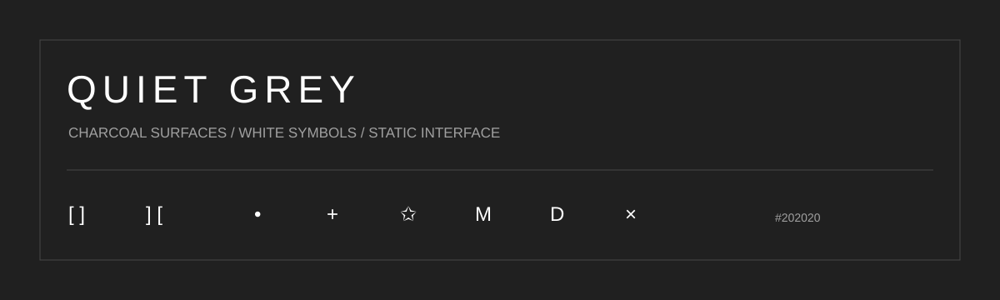
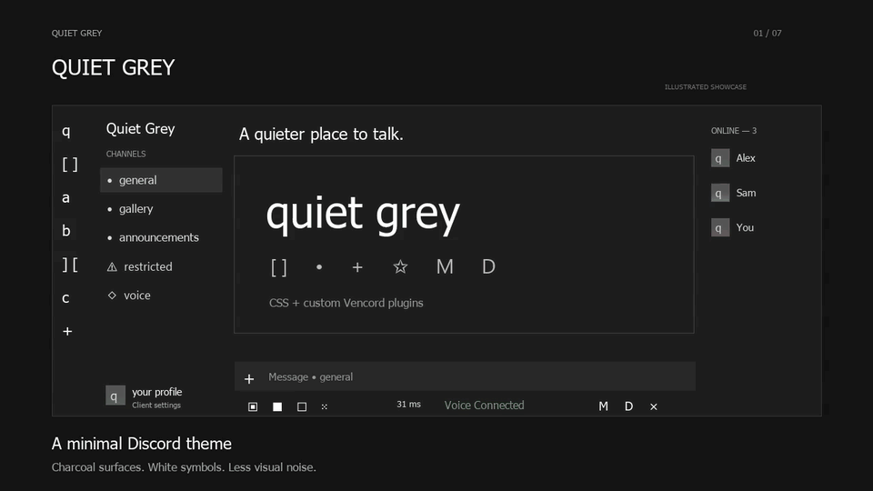

<div align="center">



**A quiet, charcoal Discord theme built around simple white symbols.**

`#202020` · `Tahoma` · `No interface animations` · `Vencord`

[Theme](Quiet-Grey.theme.css) · [Plugins](plugins) · [JavaScript](javascript) · [Installation](#installation) · [Showcase](#gif-showcase)

</div>

---

## GIF showcase

<div align="center">



[Download GIF](assets/Quiet-Grey-review.gif)

`35-second loop` · `Captions` · `No audio`

</div>

An illustrated walkthrough of the charcoal palette, white symbols, compact call controls, profile fade, and static interface. The views are recreated theme artwork rather than a live Discord recording.

---

## The idea

Quiet Grey keeps Discord visually calm: charcoal surfaces, compact controls, square avatars, white text symbols, and a static interface. The server list, member list, profile cards, and call controls share the same restrained palette.

| Detail | Treatment |
| --- | --- |
| Folder closed / open | `[ ]` / `]  [` |
| Text, forum, welcome, announcements | `•` |
| Age-restricted / voice channels | `⚠` / `🞚` |
| Invite / pinned messages | `+` / `✩` |
| Mute / deafen / disconnect | `M` / `D` / `×` |
| Add Server / Discover | `+` / hidden |
| Notifications | White counts on charcoal square badges |
| Presence | Static color tint inside the avatar's lower edge |
| Voice connection | Compact bar beneath the message input, numeric ping |

The theme hides member-list activity, offline members, Events, Server Boosts, and selected header controls. These are opinionated defaults; edit the labeled CSS sections to restore them.

## Installation

### Theme

1. Install [Vencord](https://vencord.dev/) and select Discord's dark appearance.
2. Download [Quiet-Grey.theme.css](Quiet-Grey.theme.css).
3. Paste its contents into **Settings → Vencord → Themes → QuickCSS**, and enable Custom CSS.

The CSS also works with theme loaders that support `.theme.css`, but the companion plugins require Vencord. The call-bar layout and avatar presence tint need their matching plugins.

### Companion plugins

These are custom Vencord plugins, not standalone browser scripts or BetterDiscord plugins. They need a source build of [Vencord](https://github.com/Vendicated/Vencord).

For each desired file in `plugins/`, create a matching folder in your Vencord checkout (for example `src/userplugins/quietBottomBar/`) and copy the file into it as `index.ts`. Then follow Vencord's build and injection instructions. Restart Discord after installing the build and enable the plugins under Vencord settings.

| Plugin | Purpose | Recommended |
| --- | --- | --- |
| QuietBottomBar | Aligns call controls beneath chat and adds numeric latency | Enabled |
| QuietStaticStatus | Maps native presence states to the avatar tint | Enabled |
| QuietAvatarSettings | Opens client account settings from the local avatar and randomizes kaomoji on hover | Enabled |
| QuietLetterLight | Optional letter-by-letter speaking-name effect | **Disabled** in the static preset |

`javascript/` contains readable JavaScript versions of the same plugins. The TypeScript files are the canonical installation sources; don't install both versions of a plugin.

### Automatic CSS reload on Windows

Vencord watches QuickCSS. The optional `Sync-Quiet-Grey.ps1` copies this repository's CSS into QuickCSS whenever it changes:

```powershell
powershell -NoProfile -File .\Sync-Quiet-Grey.ps1
```

This replaces the contents of Vencord's QuickCSS file. Back up any existing custom CSS first. The watcher runs until the process is stopped; it doesn't install a startup task itself.

## Latest refinements

- Eight kaomoji expressions chosen randomly on hover, without immediate repeats.
- Composer symbols and voice controls have adjusted visual alignment.
- Windows accent colors for connection text, active sharing, and gift controls. The Windows sync script reads the DWM accent and refreshes it automatically.


- Simple white `+` for Add Server; Discover is fully hidden.
- Server scrolling ends above the profile fade.
- Local profile fades upward from `#202020` to transparent.
- Native speaking rings are hidden to preserve square avatars.

## Notes

The theme and companion plugins were checked in a local Discord/Vencord client. Discord class names and DOM structure can change with updates; another release or client layout may need adjustments. There is no measured FPS or RAM guarantee.

The SVG header is theme artwork, not a screenshot. No account settings, private messages, avatars, credentials, or Vencord binaries are included.

## License

GPL-3.0-or-later. See [LICENSE](LICENSE). Plugin headers retain their license notices.

## Selector cleanup in 5.1.0

The stylesheet now uses concrete Discord component classes: no universal selectors and no substring, prefix, or suffix attribute selectors. The cleanup replaced 523 substring selectors and removed 7 universal selectors. See [selector-cleanup-report.json](selector-cleanup-report.json).

Class names are tied to the Discord build checked during development and may require updates when Discord changes them. The CSS audit is not website approval; account or submission restrictions must be resolved with the site moderation team.
